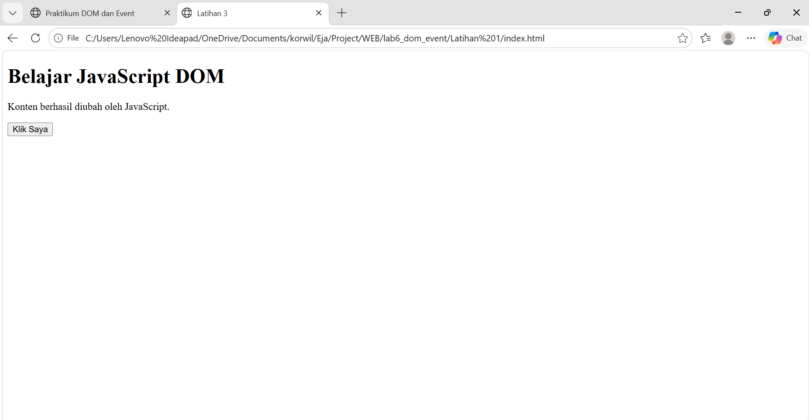
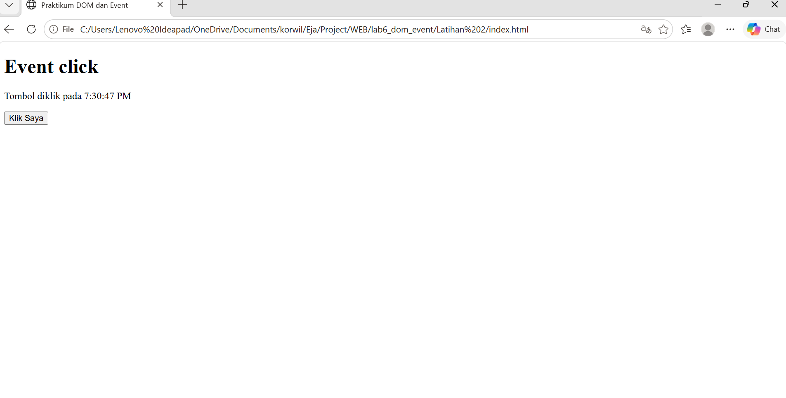
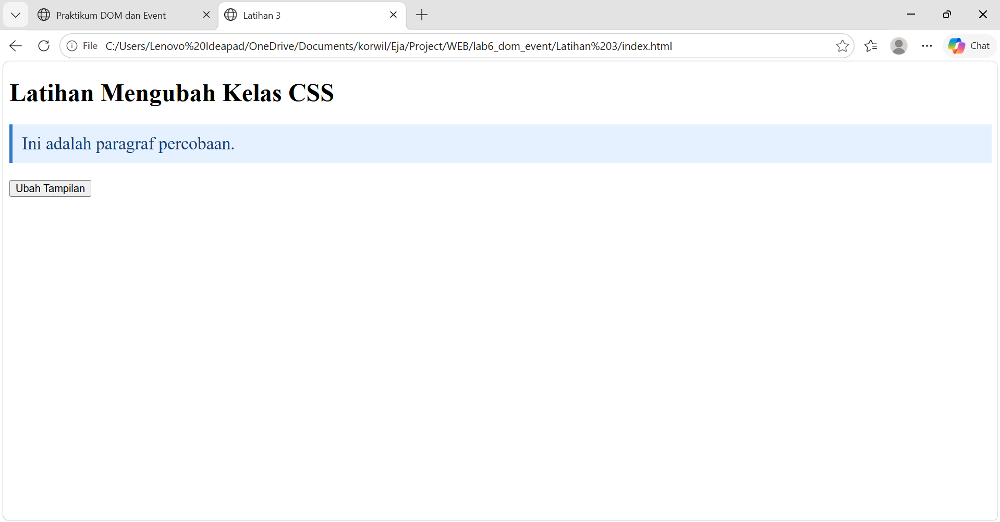
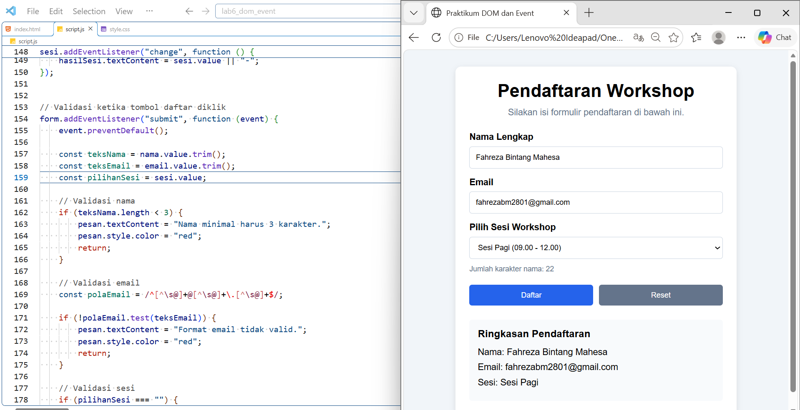
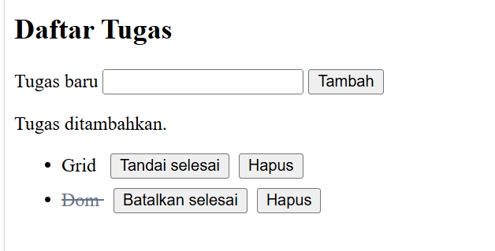

# PRAKTIKUM 6 — JavaScript DOM dan Event Handling

## Identitas Mahasiswa

- **Nama:** Fahreza Bintang Mahesa
- **NIM:** 312110220
- **Kelas:** I253A
- **Mata Kuliah:** Pemrograman Web

## 1. Tujuan Praktikum

Praktikum ini bertujuan untuk memahami penggunaan JavaScript DOM (Document Object Model) dan Event Handling dalam pengembangan halaman web interaktif.

Adapun tujuan khusus dari praktikum ini adalah:

1. Memahami konsep DOM sebagai representasi struktur dokumen HTML.
2. Menggunakan JavaScript untuk memilih dan memanipulasi elemen HTML.
3. Memahami penggunaan `addEventListener()` untuk menangani interaksi pengguna.
4. Mengubah teks, atribut, dan class CSS melalui JavaScript.
5. Membuat validasi form berdasarkan input pengguna.
6. Mengembangkan halaman web interaktif menggunakan HTML, CSS, dan JavaScript.

## 2. Struktur Folder dan File

Project ini terdiri dari beberapa file HTML, CSS, dan JavaScript yang digunakan untuk menyelesaikan latihan praktikum serta mini project.

```text
Lab6Web/
│
├── latihan1/
├── latihan2/
├── latihan3/
├── latihan4/
├── latihan5/
├── latihan6/
│
└── mini-project/
    ├── index.html
    ├── style.css
    └── script.js
```

**Keterangan:**

- `latihan1` sampai `latihan6` berisi pengerjaan latihan praktikum JavaScript DOM dan Event Handling.
- `mini-project` berisi aplikasi Form Pendaftaran Workshop.
- `index.html` digunakan untuk membuat struktur halaman web.
- `style.css` digunakan untuk mengatur tampilan halaman.
- `script.js` digunakan untuk mengatur fungsi dan interaksi halaman menggunakan JavaScript.

## 3. Cara Menjalankan Project

Berikut langkah-langkah untuk menjalankan mini project:

1. Download atau clone repository `Lab6Web` ke komputer.
2. Buka folder project menggunakan Visual Studio Code.
3. Masuk ke folder `mini-project`.
4. Pastikan file `index.html`, `style.css`, dan `script.js` berada dalam satu folder.
5. Buka file `index.html` menggunakan browser seperti Google Chrome.
6. Form pendaftaran workshop akan ditampilkan dan dapat digunakan.

## 4. Langkah Kerja

### A. Latihan Praktikum

Pada bagian latihan, dilakukan beberapa percobaan untuk memahami konsep DOM dan Event Handling, yaitu:

1. Mengubah teks menggunakan DOM.
2. Menggunakan event click untuk menjalankan perintah ketika tombol diklik.
3. Mengubah class CSS menggunakan `classList.toggle()`.
4. Menggunakan event input untuk menghitung jumlah karakter.
5. Membuat validasi form pendaftaran.
6. Membuat aplikasi daftar tugas sederhana (To-do List) dengan fitur menambahkan dan menandai tugas selesai.

### B. Mini Project — Form Pendaftaran Workshop

Mini project dibuat dengan mengembangkan halaman pendaftaran workshop menggunakan HTML, CSS, dan JavaScript.

Fitur yang diterapkan dalam aplikasi ini meliputi:

1. **Validasi Nama:** Memeriksa nama peserta agar tidak kosong dan memenuhi batas minimal karakter.
2. **Validasi Email:** Memeriksa format email yang dimasukkan pengguna.
3. **Pilihan Sesi Workshop:** Menyediakan pilihan sesi pagi dan siang.
4. **Penghitung Karakter:** Menghitung jumlah karakter nama secara langsung ketika pengguna mengetik.
5. **Ringkasan Pendaftaran:** Menampilkan nama, email, dan sesi yang dipilih.
6. **Pesan Kesalahan dan Sukses:** Menampilkan informasi berdasarkan hasil validasi formulir.
7. **Tombol Reset:** Menghapus input dan mengembalikan ringkasan ke kondisi awal.

Dalam pengerjaannya, JavaScript menggunakan beberapa metode dan event, seperti `getElementById()`, `addEventListener()`, `textContent`, `input`, `change`, `submit`, dan `reset`.

## 5. Screenshot Hasil Praktikum

Dokumentasi berikut digunakan untuk menunjukkan hasil pengerjaan latihan dan mini project.

### A. Hasil Latihan Praktikum

### Dokumentasi 

### 1. Mengubah teks dengan DOM  
 

### 2. Praktikum DOM dan Event
 

### 3. Mengubah Kelas CSS 
 

### 4. Event input dan penghitung karakter
 

### 5. Validasi Form Pendaftaran
.png) 

### 6. 	Aplikasi To-do List
 


### B. Hasil Mini Project

.png)

